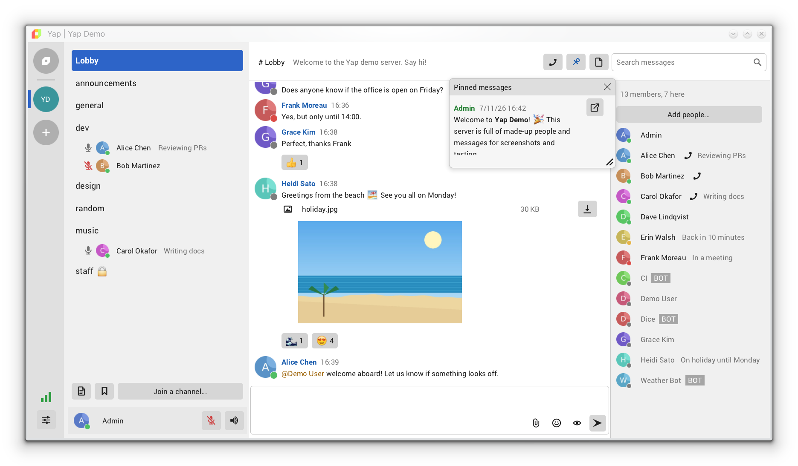

A sloppy chat and VOIP application.

- Single binary client and server (client about 10 MiB, server about 5 MiB)
- Runs on Linux, Windows, macOS (and optionally in a browser)
- Uses only UDP (WebSocket for web client)
- Minimal runtime dependencies (Glfw on Linux)
- Uses [noise protocol](https://noiseprotocol.org) for encryption between client and server\*
- Uses [RNN](https://github.com/xiph/rnnoise) and Opus
- Channels to subscribe to, each with a voice room and persistent chat
- Client can join multiple servers
- File attachments, message reactions, custom emotes
- Optional account registration via email confirmation or with invite codes
- Basic user roles with permissions
- Pin, link and forward messages
- Screen sharing ([optional component for native clients](docs/Screenshare.md))
- Bot accounts, and an HTTP/JSON API with an event WebSocket for them ([API.md](docs/API.md))
- Lua scripts in the client: react to messages, add `/commands`, change what is shown or sent, make web requests ([Scripting.md](docs/Scripting.md))
- Global hotkeys (requires `input` group on wayland)
- Option to share audio of a specific application (native clients only)

*I have no idea how encryption works.

For a more minimal version more similar to Mumble check out the
[minimal](https://github.com/univrsal/yap/tree/minimal) branch.

See [the tutorial video](https://www.youtube.com/watch?v=zcZ0UOpUYG4) for basic
server and client usage.

### Goals

Many want a Discord replacement but the bitter lesson is that there won't be one.
Someone could release a 1:1 feature complete Discord alternative today and most
would still not use it because it doesn't have the user base. So this should
be more thought of as an alternative to Mattermost.

The goal here is to make a chat application that contains most features within
reason while trying to keep it somewhat lightweight (without having to manually
write 100k lines of code). Specifically that means:

- Both the client and server have to be easy to setup,
- no overly cosmetic features (i.e. advanced profile customization),
- try to keep memory usage low,
- no focus on scalability (i.e. a server with 10,000 users is out of scope),
- while the web client does run on mobiles, primary focus is on desktop users.

### [Running a server](docs/Server.md)

### [Building](docs/Building.md)
