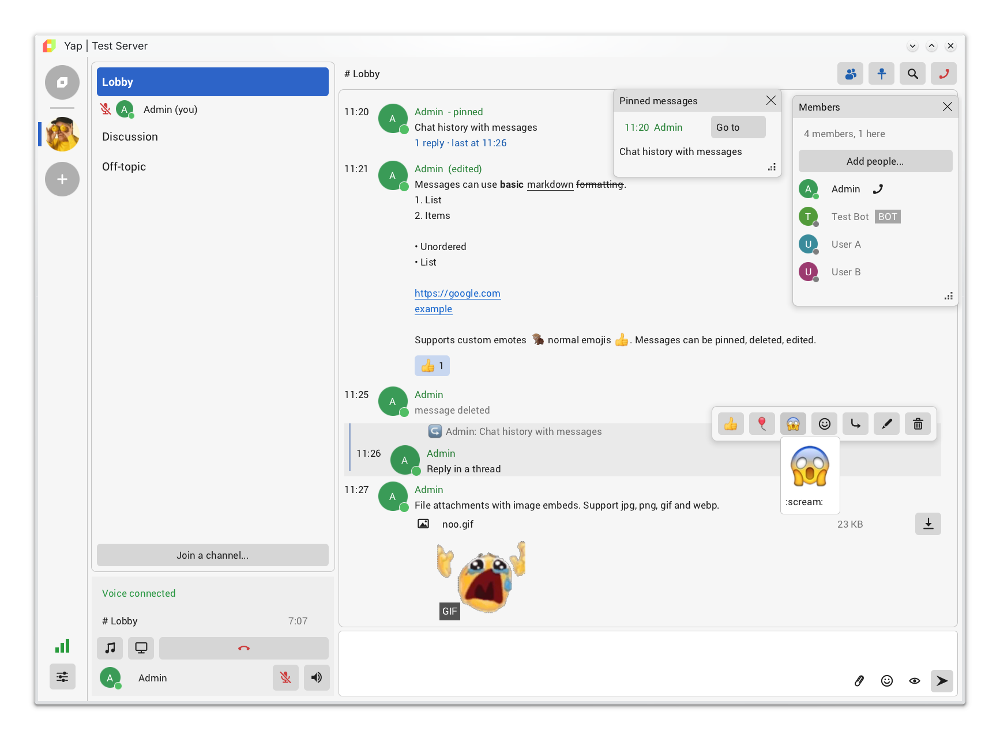

A sloppy chat and VOIP application.

- Single binary client and server (client about 10 MiB, server about 5 MiB)
- Runs on Linux, Windows, macOS (and optionally in a browser)
- Uses only UDP (WebSocket for web client)
- Minimal runtime dependencies (Basically only Glfw, some optional ones for extra features)
- Uses [noise protocol](https://noiseprotocol.org) for encryption between client and server\*
- Uses [RNN](https://github.com/xiph/rnnoise) and Opus (three quality options)
- Channels to subscribe to, each with a voice room and persistent chat
- Client can join multiple servers
- File attachments, message reactions, custom emotes
- Optional account registration via email confirmation or with invite codes
- Basic user roles with permissions
- Pin, link and forward messages
- Screen sharing (optional component for native clients)
- Bot accounts, and an HTTP/JSON API with an event WebSocket for them ([API.md](docs/API.md))
- Global hotkeys (requires `input` group on wayland)
- Option to share audio of a specific application (native clients only)

For a more minimal version more similar to Mumble check out the
[master](https://github.com/univrsal/yap/tree/master) branch.

## Running a server

```sh
yap-server               # or: yap-server path/to/config.json
```

The first run writes `config.json`: the port, the server's private key, an
optional password, logging, the web relay. By default there's only the lobby
channel. The admin can create more from the client's Channels window). Next to
it, or in the config's `data_dir`, the server keeps its database (`yap.db`) and
a `blobs` folder.

People need an account to get in, and accounts are made by an admin. A
server that has none makes one called `admin` when it starts and writes its
password to the log, once; log in with that, choose a password of your
own, and make the others from the client's settings. The same can be done
without a client:

```sh
yap-server account list
yap-server account add <username>      # prints a first password
yap-server account passwd <username>   # a new one, if it was forgotten
```
