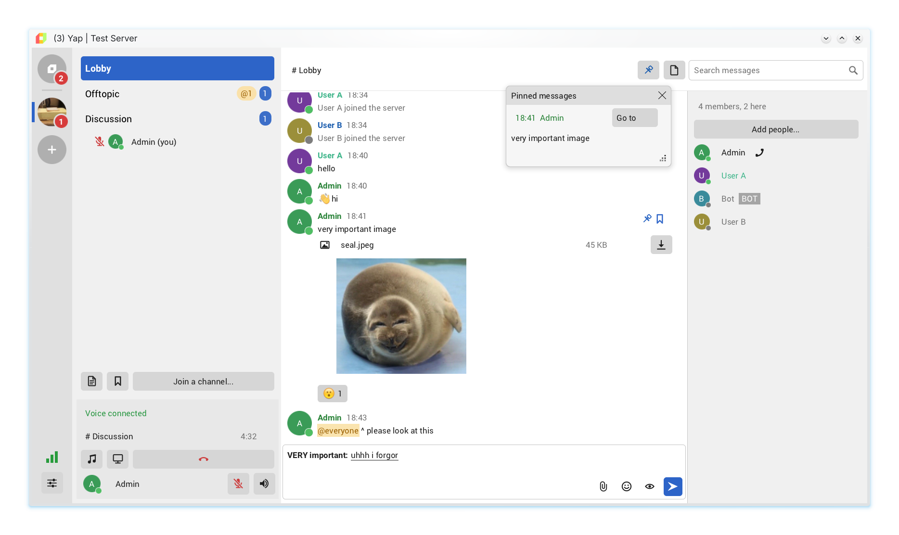

A sloppy chat and VOIP application.

- Single binary client and server (client about 10 MiB, server about 5 MiB)
- Runs on Linux, Windows, macOS (and optionally in a browser)
- Uses only UDP (WebSocket for web client)
- Minimal runtime dependencies (Basically only Glfw, some optional ones for extra features)
- Uses [noise protocol](https://noiseprotocol.org) for encryption between client and server\*
- Uses [RNN](https://github.com/xiph/rnnoise) and Opus (three quality options)
- Channels to subscribe to, each with a voice room and persistent chat
- Client can join multiple servers
- File attachments, message reactions, custom emotes
- Optional account registration via email confirmation or with invite codes
- Basic user roles with permissions
- Pin, link and forward messages
- Screen sharing ([optional component for native clients](docs/Screenshare.md))
- Bot accounts, and an HTTP/JSON API with an event WebSocket for them ([API.md](docs/API.md))
- Global hotkeys (requires `input` group on wayland)
- Option to share audio of a specific application (native clients only)

For a more minimal version more similar to Mumble check out the
[minimal](https://github.com/univrsal/yap/tree/minimal) branch.

See [the tutorial video](https://www.youtube.com/watch?v=zcZ0UOpUYG4) for basic
server and client usage.

### [Running a server](docs/Server.md)
